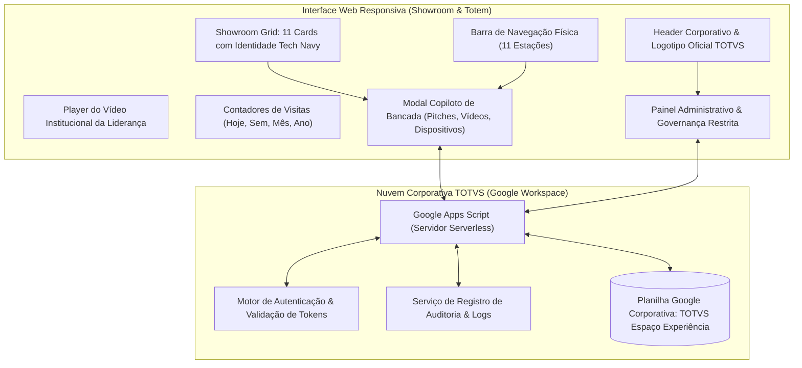

# TOTVS | Espaço Experiência
## Documento Executivo de Apresentação de Projeto & Governança

---

**Projeto**: Hub de Segmentos & Gestão Operacional do Espaço Experiência TOTVS  
**Autor & Liderança Técnica**: André Gianotti — Analista de Segmentos (`andre.gianotti@totvs.com.br`)  
**Unidade / Organização**: TOTVS S.A. • Espaço Experiência  
**Ambiente de Hospedagem**: Nuvem Corporativa TOTVS (Google Workspace / Google Apps Script / Google Sheets)  
**Versão do Documento**: 2.0 — Versão Oficial de Produção  
**Público-Alvo**: Gestores, Diretores, Product Marketing Managers (PMMs), Coordenadores e Especialistas de Negócio  

---

## 1. Sumário Executivo (Executive Summary)

O **Espaço Experiência TOTVS** é o principal laboratório físico e tecnológico da companhia para demonstração prática de soluções, recebimento de clientes estratégicos (C-level), parceiros e prospects. 

Com o crescimento do portfólio e a complexidade das 11 verticais representadas no laboratório, identificou-se a necessidade de centralizar e padronizar o conhecimento técnico e operacional do espaço em uma **plataforma única, interativa, segura e de altíssima disponibilidade**.

Concebido e desenvolvido internamente pelo Analista de Segmentos **André Gianotti**, o **Hub do Espaço Experiência** resolve o desafio de dispersão de roteiros, unifica o discurso de vendas e tecnologia da companhia, consolida as credenciais de equipamentos físicos das bancadas e oferece à liderança **visibilidade analítica em tempo real de visitações e governança descentralizada**.

A solução foi implementada com **Custo Adicional Zero (R$ 0,00)** em infraestrutura externa, operando 100% hospedada sobre a **Nuvem Corporativa TOTVS**, atendendo aos mais rigorosos requisitos de conformidade, segurança da informação e identidade visual corporativa da marca.

---

## 2. Objetivos Estratégicos do Projeto

```
┌────────────────────────────────────────────────────────────────────────┐
│                   OBJETIVOS ESTRATÉGICOS PRINCIPAIS                    │
├─────────────────────┬────────────────────┬─────────────────────────────┤
│ 1. Alinhamento de   │ 2. Eficiência      │ 3. Inteligência de Dados    │
│    Discurso         │    Operacional     │    & Governança             │
│ • Pitch de 1 minuto │ • Credenciais de   │ • Métricas em tempo real de │
│   padronizado por   │   bancadas físicas │   visitantes (dia/mês/ano)  │
│   estação           │ • Cópia rápida em  │ • Escala de plantonistas    │
│ • Dores do mercado  │   1 clique         │ • Rastreamento de edições   │
│ • Vídeos de postura │ • Fotos dos PCs e  │   (Auditoria PMM/ADM)       │
│   e roteiro         │   dispositivos     │                             │
└─────────────────────┴────────────────────┴─────────────────────────────┘
```

1. **Padronização e Nivelamento do Discurso (Pitch de Alto Impacto)**:
   * Capacitar qualquer analista ou especialista de plantão a demonstrar qualquer estação com precisão cirúrgica, utilizando discursos sintetizados de 1 minuto, perguntas provocativas e dados reais de mercado.
2. **Eliminação do Atrito Técnico nas Demonstrações (Quick Access)**:
   * Acabar com anotações em papel ou planilhas dispersas contendo senhas de computadores, coletores, impressoras e totens da bancada física.
3. **Gestão Transparente da Escala dos Plantonistas**:
   * Calendário dinâmico mensal permitindo que recepcionistas, gestores e visitantes saibam exatamente quem é o especialista em campo, seu turno e ramal de contato.
4. **Métricas Executivas de Visitação em Tempo Real**:
   * Registro ágil e consolidado de visitas com 3 categorias corporativas (*Cliente*, *Prospect*, *Parceiro/Interno*), gerando indicadores consolidados para prestação de contas à diretoria.
5. **Governança Descentralizada com Rastreabilidade Total**:
   * Empoderamento dos Gerentes de Produto e Marketing (PMMs) para manterem suas próprias estações atualizadas, com registro estrito de auditoria protegendo a integridade da base.

---

## 3. Matriz de Perfis de Acesso & Governança (RBAC)

O sistema foi arquitetado em conformidade com o princípio de **mínimo privilégio e máximo dinamismo operacional**, oferecendo três perfis de navegação:

| Perfil de Usuário | Mecanismo de Entrada | Finalidade & Permissões | Nível de Segurança |
| :--- | :--- | :--- | :--- |
| **Plantonista / Visitante Interno** | **Acesso Livre (Sem Login)** | • Consulta imediata no totem, notebook ou tablet.<br>• Leitura de pitches, roteiros, fotos e vídeos.<br>• Consulta a credenciais de computadores de bancada.<br>• Registro rápido de novos visitantes.<br>• Visualização da escala de plantão. | • Zero atrito para o atendimento rápido ao cliente.<br>• Sem permissão de alteração de conteúdo. |
| **PMM (Product Marketing Manager)** | **Autenticação Segura via Convite Individual** | • Edição exclusiva dos dados da sua estação temática.<br>• Atualização de pitches de 1 minuto, dores e roteiros.<br>• Vínculo e substituição do vídeo de demonstração.<br>• Cadastro e edição de dispositivos e fotos da bancada.<br>• Visualização do histórico de edições do seu segmento. | • Convite nominal gerado pelo Administrador com token criptográfico de uso único.<br>• Obrigatoriedade de troca de senha no 1º acesso.<br>• Todas as alterações registradas em log de auditoria. |
| **Administrador Geral (Dono do Produto)** | **Autenticação Restrita com Credencial Mestra** | • Gestão completa e irrestrita de todas as 11 estações.<br>• Painel analítico de métricas consolidadas de visitas.<br>• Geração, envio e revogação instantânea de convites PMM.<br>• Consulta e filtragem avançada de logs de auditoria e acesso.<br>• Gerenciamento da escala de especialistas e vídeo da liderança.<br>• Exportação de relatórios e backups completos. | • Acesso restrito ao Dono do Produto (André Gianotti).<br>• Dupla camada de validação e proteção de rota administrativa. |

---

## 4. Arquitetura de Funcionalidades do Sistema



### 4.1. Showroom Interativo das 11 Estações Físicas
1. **TOTVS Agro**: Multicultivo, Gestão de Grãos, Bioenergia e Conexão da Lavoura à Mesa.
2. **TOTVS Manufatura**: Planejamento, Manutenção de Ativos, APS Avançado e Gestão de Chão de Fábrica.
3. **Backoffice**: ERPs TOTVS Protheus e Linha Datasul, Controladoria, Gestão Financeira e Fiscal.
4. **TOTVS MES / PPI Multitask**: Indústria 4.0, Apontamento IoT em Tempo Real e Eficiência OEE.
5. **TOTVS Logística**: TOTVS WMS, TMS, Torre de Controle e Cockpit Logístico Integrado.
6. **Loja TOTVS Moda**: Soluções para Varejo Têxtil, Franquias, PDV Omni e Rastreabilidade RFID.
7. **Loja TOTVS Consinco**: Supermercados, Atacarejo, Self-Checkout Inteligente e Prevenção de Perdas.
8. **TOTVS Varejo On-line**: Plataformas de E-commerce, Marketplace, Integração Omnichannel e CRM.
9. **TOTVS RM Clínicas**: Gestão Hospitalar, Consultórios, Prontuário Eletrônico e PEP Integrado.
10. **Mesa Interativa**: Tecnologia touchscreen corporativa, infográficos interativos e visualização de ecossistema.
11. **Soluções Cross**: Inteligência Artificial Carol, TOTVS Fluig, RH/HCM, Analytics e Plataformas de Pagamento.

### 4.2. Modo Copiloto de Bancada (Guia de Demonstração)
* **Discurso de Plantão (Pitch de 1 Minuto)**: Texto formatado e revisado para abertura de reuniões e visitas guiadas, permitindo leitura rápida e fluida.
* **Vídeo Demonstrativo do Especialista**: Player integrado com suporte nativo a vídeos do Google Drive e streaming direto, demonstrando postura, narrativa e telas-chave do sistema.
* **Bancada Física & Credenciais de Computador**: Listagem de todos os equipamentos (notebooks, desktops, coletores Android Zebra, impressoras 3D, monitores touchscreen) com fotos reais e botão de cópia de usuário/senha em 1 clique.
* **Perguntas Provocativas para o Visitante**: Roteiro com 2 a 3 perguntas inteligentes para conectar as dores do lead com as soluções do portfólio TOTVS.

### 4.3. Vídeo Institucional da Liderança
* Localizado em destaque no topo da interface (*"Discurso da Liderança"*), permitindo que a mensagem estratégica de diretores e vice-presidentes seja exibida aos visitantes em ocasiões especiais.
* Suporta atualização remota de link, título e subtítulo pelo Administrador sem necessidade de nova versão de código.

### 4.4. Inteligência de Visitação (Contadores & Registro Ágil)
* **Barra de Indicadores**: Exibição em tempo real do total de visitantes computados:
  * *Hoje* | *Esta Semana* | *Este Mês* | *No Ano*.
* **Modal de Registro em 3 Cliques**: O plantonista seleciona a categoria (*Cliente*, *Prospect* ou *Parceiro/Interno*), digita a empresa e a quantidade de pessoas, salvando imediatamente na planilha Google da TOTVS.
* **Lembrete Ativo das 17:00**: Notificação amigável e expansível alertando os especialistas sobre o fechamento das visitas diárias.

### 4.5. Painel de Governança e Auditoria Administrativa
* **Gestão de Convites PMM**: Geração de links personalizados com controle de e-mail corporativo (`@totvs.com.br`), expiração de prazo e revogação imediata em lote ou individual.
* **Auditoria Restrita**: Rastreamento completo de qualquer edição feita no sistema (quem alterou, qual segmento, data, horário exato e descrição das alterações).
* **Logs de Acesso**: Monitoramento de entrada de analistas, PMMs e administradores para segurança da informação.

---

## 5. Aspectos Técnicos & Conformidade na Nuvem TOTVS

```
┌────────────────────────────────────────────────────────────────────────┐
│                   STACK TECNOLÓGICA 100% CORPORATIVA                   │
├─────────────────────┬────────────────────┬─────────────────────────────┤
│ Camada              │ Tecnologia         │ Justificativa Estratégica   │
├─────────────────────┼────────────────────┼─────────────────────────────┤
│ Frontend            │ React 18 +         │ Interface ultrarrápida,     │
│                     │ Tailwind CSS       │ responsiva e padronizada    │
├─────────────────────┼────────────────────┼─────────────────────────────┤
│ Identidade Visual   │ Vetor Oficial SVG  │ Resolução infinita da marca │
│                     │ + Paleta 2026      │ TOTVS e fita 3D oficial     │
├─────────────────────┼────────────────────┼─────────────────────────────┤
│ Backend             │ Google Apps Script │ Serverless nativo Google    │
│                     │ (V8 Engine)        │ Workspace corporativo       │
├─────────────────────┼────────────────────┼─────────────────────────────┤
│ Banco de Dados      │ Google Sheets API  │ Sem custo, auditoria fácil, │
│                     │ (Estruturado)      │ exportável para Excel/BI    │
├─────────────────────┼────────────────────┼─────────────────────────────┤
│ Armazenamento Mídia │ Google Drive TOTVS │ Vídeos e fotos corporativas │
│                     │ + GitHub Raw       │ protegidos no domínio       │
└─────────────────────┴────────────────────┴─────────────────────────────┘
```

### 5.1. Segurança da Informação & Compliance LGPD
* **Isolamento de Domínio**: O Web App roda sob a chancela `macros/totvs.com.br`, permitindo restringir a execução exclusivamente a usuários autenticados na rede ou Google Workspace da TOTVS.
* **Blindagem de Credenciais**: Acesso administrativo desacoplado de senhas de rede pessoal, utilizando tokens criptografados e proteção contra ataques de injeção.
* **Integridade de Codificação (UTF-8 Estrito)**: Sistema auditado com zero tolerância a caracteres corrompidos, garantindo fidelidade de acentuação e padronização visual em qualquer dispositivo (desktop, totem vertical ou tablet).

### 5.2. Custo Total de Propriedade (TCO) & Eficiência
* **Custo Adicional de Licenciamento**: **R$ 0,00**.
* **Custo de Hospedagem em Servidores de Terceiros**: **R$ 0,00**.
* **Dependência de Equipes Externas**: **Zero**.
* **Manutenibilidade**: A base de dados estruturada no Google Sheets permite que qualquer relatório seja extraído em segundos via exportação para Microsoft Excel ou conectado diretamente ao Power BI / TOTVS Analytics.

---

## 6. Retorno sobre o Investimento Institucional (ROI)

| Indicador de Negócio | Situação Anterior (Sem o Hub) | Situação Atual (Com o Hub de Segmentos) | Ganho Comprovado |
| :--- | :--- | :--- | :--- |
| **Tempo de Preparação do Plantonista** | 15 a 20 minutos procurando apresentações e logins | Menos de 30 segundos com acesso direto à estação | **Redução de 95% no tempo de setup** |
| **Consistência do Discurso de Vendas** | Disperso, dependente da memória individual | Pitch estruturado de 1 min homologado pelo PMM | **Padronização corporativa em 100% das visitas** |
| **Falha de Conexão em Bancadas** | Travamentos por esquecimento de senhas de PC | Senha e usuário visíveis com cópia em 1 clique | **Eliminação de chamados de suporte técnico no showroom** |
| **Visibilidade de Visitação pela Gestão** | Contagem manual ou inexistente | Dashboard com total diário, semanal, mensal e anual | **100% de precisão nos relatórios para a diretoria** |
| **Atualização de Conteúdo por PMM** | Dependência de TI ou solicitação por e-mail | Edição descentralizada via formulário validado | **Agilidade e autonomia com auditoria completa** |

---

## 7. Próximos Passos & Evolução do Projeto

1. **Integração com TOTVS Fluig**:
   * Automação de agendamento prévio de visitas VIP com envio de link de briefing aos clientes.
2. **Conexão Direta com CRM Corporativo**:
   * Registro automático dos visitantes e empresas no pipeline de oportunidades de negócios das equipes comerciais.
3. **Dashboard Executivo no Power BI**:
   * Conexão nativa da planilha do Google Sheets ao Power BI da gerência para visualização de gráficos de calor e sazonalidade de visitas por estação.

---

## 8. Conclusão & Aprovação da Liderança

O **Hub de Segmentos do Espaço Experiência TOTVS** consolida-se como um ativo tecnológico e institucional de alto valor para a companhia. Desenvolvido com rigor técnico, sustentabilidade financeira e alinhamento com a identidade visual da marca, o sistema entrega governança, padronização e profissionalismo no atendimento aos principais clientes da TOTVS no Brasil e na América Latina.

---

**Responsável Técnico pelo Projeto**:  
**André Gianotti**  
*Analista de Segmentos — TOTVS S.A.*  
E-mail: `andre.gianotti@totvs.com.br`  

---
*TOTVS S.A. • Espaço Experiência • Outubro / 2026*
